<!-- header:start: repo-site/tools/header.js writes this block from docs/site/header.json -->
<div align="center">

<a href="#install">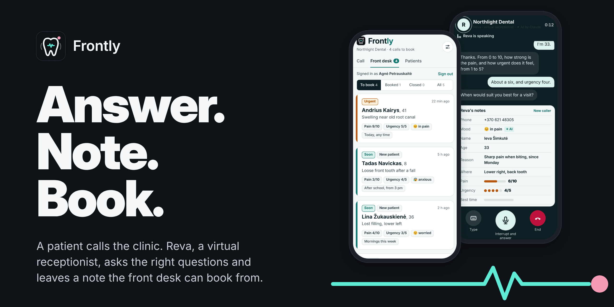</a>

<h2>A virtual receptionist that screens every caller and leaves a note ready to book</h2>

Call the office. Answer Reva. Book the visit.

<a href="#install"></a>&nbsp;&nbsp;<a href="CHANGELOG.md"></a>

<sub>Free · iPhone and iPad · Runs in the free Scriptable app · For a dental clinic, a car service or any office · AI is optional, with your own Claude or OpenAI key</sub>

[](CHANGELOG.md)
[](https://apps.apple.com/app/scriptable/id1405459188)
[](#ai)
[](docs/BLUEPRINTS.md)
[](https://github.com/gadominas/Frontly/commits)
[](LICENSE)

</div>
<!-- header:end -->

> [!IMPORTANT]
> **A demo app.** Frontly shows what a virtual receptionist can do, for a dental clinic, a car service or any office. It starts empty: you add the staff, and the clients are whoever calls. It is not meant for real patient records and gives no medical advice. See [Disclaimer](#disclaimer).

## See it in action

<p align="center">
  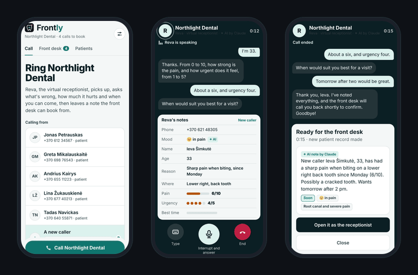
</p>

## Screenshots

<p align="center">
  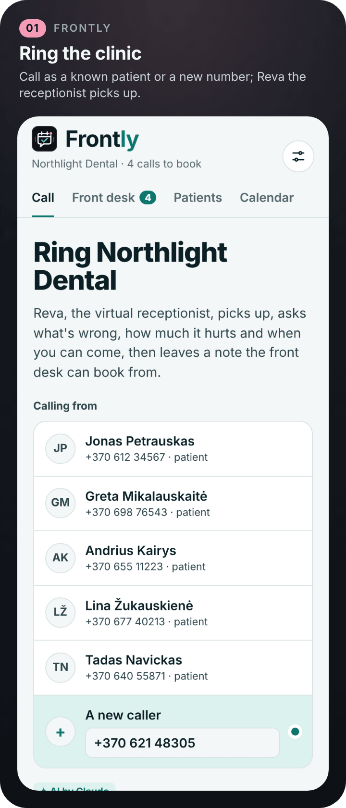
  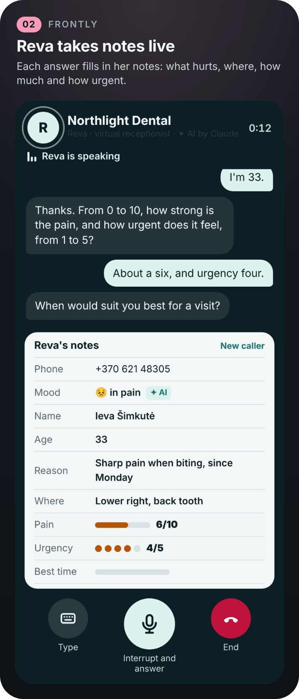
  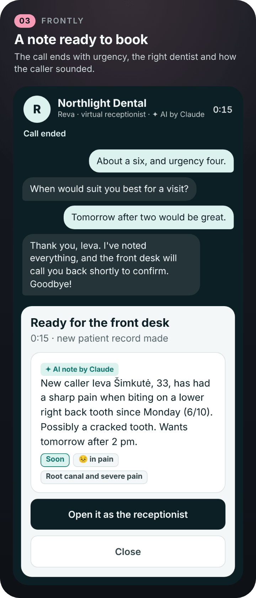
</p>
<p align="center">
  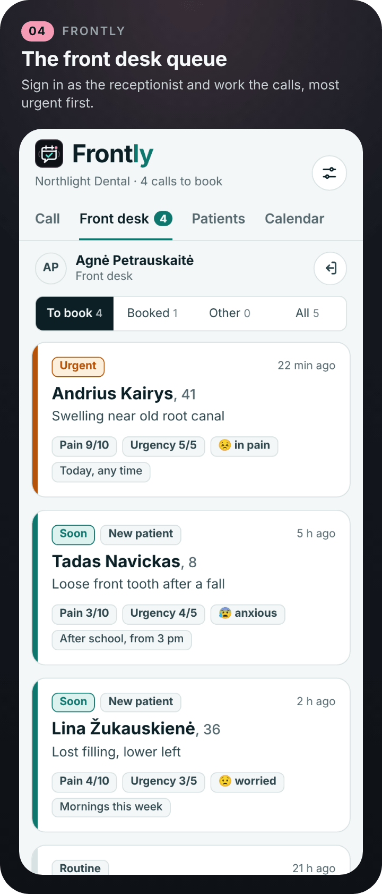
  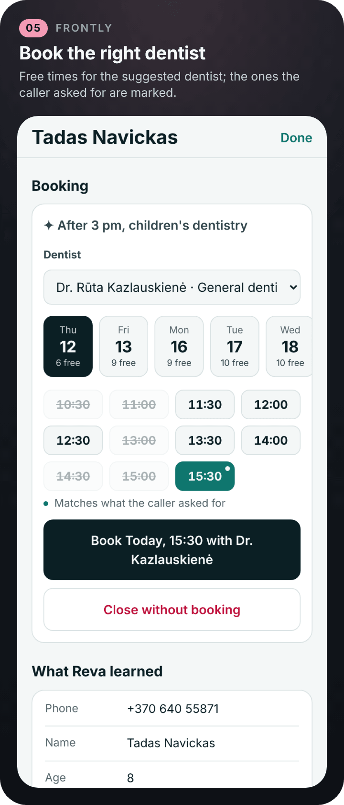
  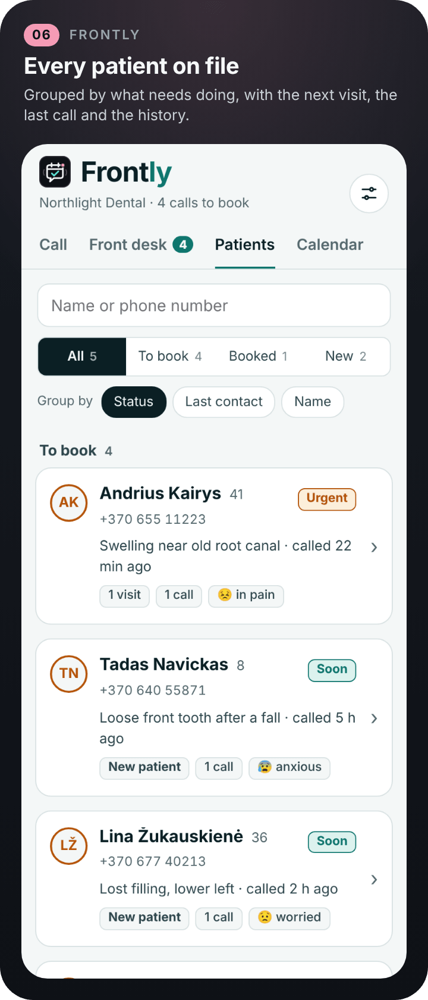
</p>
<p align="center">
  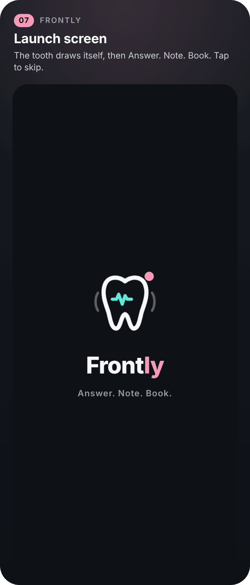
  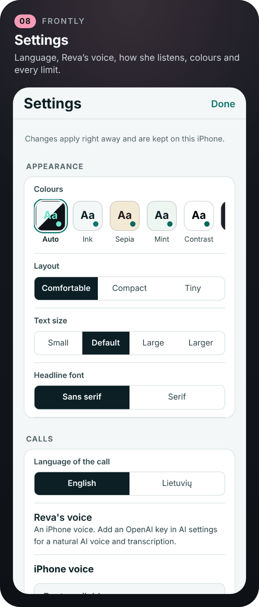
  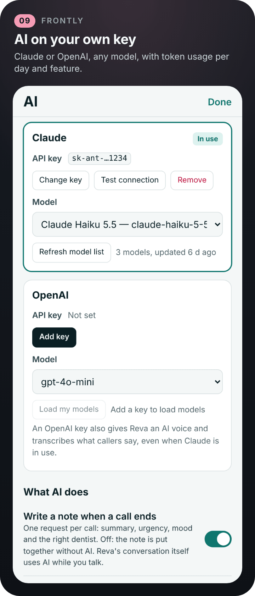
</p>
<p align="center">
  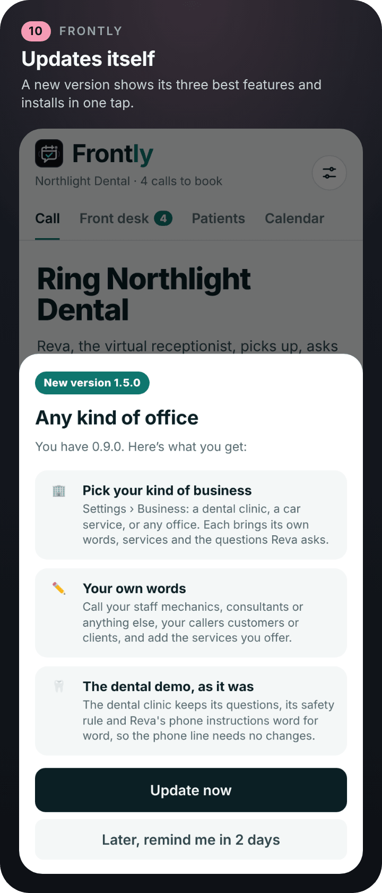
  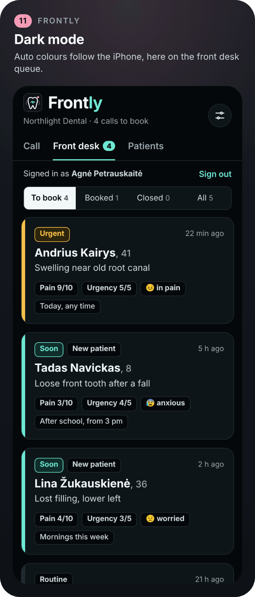
  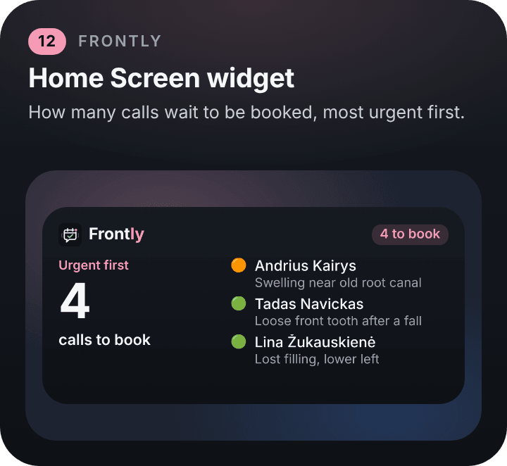
</p>

> [!NOTE]
> Screenshots are rendered from the app's real interface with invented sample data. Claude's replies in them are fixed, so every rebuild shows the same call.

## Highlights

- **Call the clinic from your iPhone.** Ring a demo dental clinic as one of its patients or from a new number. Reva, the virtual receptionist, picks up with a voice and asks one question at a time.
- **She asks what the front desk needs.** Name, age, what's wrong, where it hurts, pain from 0 to 10, how urgent it feels from 1 to 5, the best time to come, and anything else, like swelling or medicines. Answer by voice or by typing.
- **Her notes fill in as you talk.** Every answer lands in Reva's notes on screen, with a pain meter, urgency dots and, with AI, the caller's mood.
- **Known callers are recognised.** A caller's phone number finds their patient record, so Reva greets them by name and skips what she already knows. A new caller gets a record of their own.
- **A note ready to book.** When the call ends, Reva writes a summary for the front desk: how urgent it is, red flags, the right kind of dentist, a suggested dentist and when the caller can come.
- **Be the receptionist.** Sign in to the front desk, work the queue most urgent first, open a call, pick the dentist and a free time and book it. Copy a confirmation text, cancel, or close a call without booking.
- **Every patient on file.** Grouped by what needs doing (to book, visit booked, new, everyone else), by last contact or by name, with filters and search. Each card shows the next visit or the open call, visits, calls, notes, mood, and a warning when two records share a number.
- **English or Lithuanian.** Reva holds the call in either language.
- **AI is optional.** Without a key Reva follows a fixed script, labelled no AI. With a Claude or OpenAI key she holds a real conversation, reads the caller's mood and writes the note; with an OpenAI key she can also speak with an AI voice and have callers transcribed.
- **Widget, launch screen, Settings and updates** from the shared blueprints: a Home Screen widget with the calls waiting, a branded launch screen, one Settings sheet and new versions offered in the app.

## Install

1. Get **[Scriptable](https://apps.apple.com/app/scriptable/id1405459188)** (free) on your iPhone or iPad.
2. In Scriptable, tap **+**, paste these two lines, name the script *Frontly Installer*, and tap **▶**:
   ```js
   const code = await new Request("https://raw.githubusercontent.com/gadominas/Frontly/main/install.js").loadString();
   await eval("(async () => {" + code + "\n})()");
   ```
3. Tap **Open Frontly**, then tap **Call Northlight Dental**.

To update, tap **Update now** when Frontly offers a new version, or run *Frontly Installer* again. Your patients, calls and settings are kept.

<details>
<summary><b>Install by hand</b></summary>

Rather not use the loader? Paste [`install.js`](install.js) or [`Frontly.js`](Frontly.js) into a new script in Scriptable yourself.

</details>

What else you need:

- **For a real conversation:** a [Claude](https://console.anthropic.com/settings/keys) or [OpenAI](https://platform.openai.com/api-keys) API key, added in **Settings › AI settings**. Without one, Reva follows her script.
- **For Reva's AI voice and OpenAI transcription:** an OpenAI key (it works next to a Claude key).
- **For speaking your answers:** Dictation on in iOS **Settings › General › Keyboard**. You can always type instead.

## How to use it

### Make a call

1. On the **Call** tab, choose who's calling: one of the patients, or **A new caller** with any number.
2. Tap **Call Northlight Dental**. Reva answers after a ring.
3. Answer each question. With **Listen when Reva stops talking** on (Settings › Calls), the microphone opens by itself; otherwise tap **Answer**. With OpenAI transcription Reva also stops listening by herself when you pause, so a call needs no taps. Tap **Type** to type instead, or tap the microphone while Reva talks to interrupt her.
4. Reva says goodbye when she has everything, or tap **End**. The note appears; **Open it as the receptionist** takes you to the front desk.

### Work the front desk

| To… | Do this |
| --- | --- |
| Sign in | **Front desk**, pick a receptionist, PIN **1234** |
| See what needs booking | **To book**, most urgent first; **Booked**, **Other** (closed, or no booking needed) and **All** for the rest. A patient with several calls gets one card with all of them |
| Book a caller | Tap the call: the suggested time is already selected. Change the dentist, day or time if you like, tap **Book** |
| Choose how long | **How long** in the booking box: 5 min to 3 h. The suggestion says why: what the caller asked for ("an hour", "pusvalandžio"), the AI's estimate from the reason, or the service's usual length (Settings › Business). Only times with room for that long are offered |
| Book a later date | **Pick a date** beside the days opens the date picker; any day from today on, with its free times (from ClinicCards when it's in use) |
| See a client's ClinicCards visits | Open their card: their visits are fetched (at most every 10 minutes) and the card says when; **Refresh** fetches again |
| Cancel a visit | **Cancel** on the client's page or in the case: a dialog shows the visit and asks why (optional). The reason and who cancelled stay in the history |
| See what went with a booking | **Details** on a visit: the summary, every detail, the whole conversation, and the comment ClinicCards got (short, in the language of the call) |
| Move a visit | A call asking to change a booking shows **Visit to move**; pick the new time and tap **Move to …** |
| Get the AI's view | **✦ Ask AI to plan this visit** (it asks by itself when the patient has other visits, needs surgery, or wants a change) |
| See how full the clinic is | **Calendar**: each dentist's day, the week and the month as percent taken, and **Trends** |
| Send the caller a confirmation | **Copy confirmation text** on a booked call |
| Undo a booking | **Cancel appointment**, then **Confirm**; the call goes back to **To book** |
| Close a call without booking | **Close without booking**, then **Confirm** |
| Add a note | At the bottom of a call or a patient's record |

Times with a dot match what the caller asked for ("mornings", "after 3 pm", "Friday", "next week"). A patient's visits never overlap, are kept a day apart, and two surgeries are kept 14 days apart; times that break these rules are struck through, with the reason underneath (**Settings › Booking** sets both gaps).

<details>
<summary><b>What Reva asks, and what she does with it</b></summary>

| She asks | Kept as | Used for |
| --- | --- | --- |
| Your full name (new callers) | Name | The new patient record |
| How old you are (new callers) | Age | The record; children go to children's dentistry |
| What's bothering you | Reason | The summary and the kind of dentist |
| Where it hurts | Where | The summary |
| Pain from 0 to 10 | Pain | Urgency: 8 or more is urgent, 5 or more soon |
| How urgent it feels, from 1 to 5 | Urgency | Urgency: 5 is urgent, 4 soon |
| The best time to come | Best time | Marking matching times when booking |
| Anything else | Also | Red flags such as swelling, fever or bleeding |

If a caller mentions trouble breathing or swallowing, or swelling spreading towards the eye or neck, Reva tells them to call 112.

Without AI the note is put together from these answers by fixed rules; with AI, Claude or OpenAI reads the whole call and writes it.

</details>

### Take real calls (optional)

Give Reva a real phone number: a Twilio number, answered by an ElevenLabs agent with Reva's instructions, and a small free Cloudflare Worker that tells her who's calling and hands finished calls to Frontly. They land at the front desk like any other call, marked 📞, filed under the caller's record. Setup, step by step: [bridge/README.md](bridge/README.md).

### Set up your business

**Settings › Business › Kind of business** picks a template. Each one sets the words the app uses, the services callers come for, and the questions Reva asks, in English and Lithuanian, with or without AI:

| Template | Staff · callers · bookings | Reva asks about | Safety rule |
| --- | --- | --- | --- |
| Dental clinic (the demo the phone line was set up for) | dentists · patients · visits | name, age, the reason, where it hurts, pain 0–10, urgency, best time, anything else | trouble breathing or swallowing, spreading swelling, bleeding that won't stop: call 112 |
| Car service | mechanics · customers · appointments | name, the problem, the car (make, model, year), urgency (5: it can't be driven), best time, warning lights or noises | smoke, a fuel smell, failing brakes, an accident: move away from the car, call 112 if anyone is hurt |
| Office or other service | employees · clients · appointments | name, the reason, urgency, best time, anything else | none |

Rename any word underneath (an "employee" can be a "consultant", a "customer" a "driver"), and add or remove services. **Reset** puts the template's words and services back. Reva's instructions for the phone line (Settings › Phone line › Copy) follow the template; the dental clinic's are word for word what they were.

### Add your staff

**Settings › Dentists › Add** (the section takes your word for staff: Mechanics, Employees…): the name, a short name for cards and the calendar, the role, the services they do, the days they work and their hours. Bookings, the AI's suggestions and the calendar use them. **Edit** changes one; **Remove** takes one off (not while they have visits booked; past visits keep their name).

### Book into ClinicCards

**Settings › Planning** chooses where bookings live: Frontly's own diary, or ClinicCards. Each planning service has its own settings window: the API key (kept in the Keychain), a connection test, the cabinet and the note for each visit, and which ClinicCards person each staff member is (or **Import** to link and add them). With ClinicCards in use, the free times come from its shifts minus its visits, and each booking is made there first, as a visit to confirm. Cancelling or moving a visit has to be done in ClinicCards as well: Frontly says so when you do it. Details, and how to add another planning service: [docs/INTEGRATIONS.md](docs/INTEGRATIONS.md).

### Register someone without a call

Someone at the desk, or a call you took yourself: **Front desk › Register someone**, or **Patients › Add**. Enter the name, phone number (Reva recognises them by it next time) and age, and leave **Add a request to book** on to say what they need, the service (or let Frontly suggest one), how urgent it is and the best time. The request waits in **To book** marked **✎ Front desk**, and opens straight into the booking box with a time already suggested. For someone already on record, **New request** on their page does the same without asking their details again.

### Import clients and staff

**Settings › Data › Import** takes a CSV file (**Choose a file…**) or rows copied from Excel, Numbers or Google Sheets. The first row names the columns, in English or Lithuanian:

| Importing | Columns (only the starred one is needed) |
| --- | --- |
| Clients | **name**\* (or first name and last name), **phone**\*, age or birth date, notes |
| Staff | **name**\*, short name, role, services (separated by ;), days (Mon-Fri, Mon;Wed;Fri, Pr-Pn), hours (8-16) |

A preview comes first: who's new, who's already here (clients by phone number, staff by name, "Dr." or not, kept as they are) and which rows are skipped and why. Nothing is saved until **Import**. With ClinicCards set up, its window also has **Import patients**.

### Correct a client's details

On a client's page, **Edit details** changes the name, the phone number and the age (where the business asks for it). The number has to be the one they call from: Reva recognises callers by it, so two records can't share one. The new name shows everywhere and reaches the phone line at once. **Remove** takes the record away (not while a booking is ahead); their calls stay.

### Start empty again

**Settings › Data › Remove all calls and patients** clears the front desk. Dentists and settings stay.

## Widget

Shows how many calls wait to be booked, most urgent first, with who called and why. It is the shared [widgets](https://github.com/gadominas/app-blueprints/blob/main/blueprints/widgets.md) blueprint, so all the apps' widgets look alike.

1. Long-press the Home Screen, tap **Edit › Add Widget**, choose **Scriptable** and a size.
2. Long-press the widget, tap **Edit Widget**, set **Script** to *Frontly* and **When Interacting** to *Run Script*.

Lock Screen widgets are added the same way under **Customize › Lock Screen**. The widget shows what Frontly saved when it last closed, so it never waits for the network.

## AI

With a key, Reva talks with Claude or OpenAI: she asks follow-ups in her own words, reads the caller's mood from what they say, and writes the note at the end of the call with the urgency, red flags and the dentist to book. With an OpenAI key she can also speak with an AI voice (Settings › Calls › Reva's voice) and have callers' answers transcribed by OpenAI (How Reva hears you).

- **Your own key.** Open **Settings › AI settings**, add a [Claude](https://console.anthropic.com/settings/keys) or [OpenAI](https://platform.openai.com/api-keys) key, pick any model the key can use and tap **Test connection**. An OpenAI key also powers the AI voice and transcription, even when Claude runs the conversation.
- **Kept safe.** The key is typed into a native iOS prompt, stored in the iOS Keychain and sent only to its own provider. The app's page never sees it.
- **You see the cost.** **AI settings › Token usage** shows tokens per day, feature (Conversation, Call notes, Reva's voice, Transcription) and model. API use is billed by the provider, separately from any chat subscription.
- **Optional.** Without a key Reva follows a fixed script with an iPhone voice and iPhone dictation, and the note is put together without AI. Everything else works the same.

## Settings

Tap the sliders icon at the top. Changes apply at once and are saved in `settings.json` in iCloud Drive › Scriptable › Frontly, so updates never reset them.

| Section | What you can change |
| --- | --- |
| Appearance | Colours (Auto or six palettes), layout (Comfortable, Compact, Tiny), text size, headline font |
| Calls | Language of the call, Reva's voice (iPhone or AI voice, which voice, how she sounds), how Reva hears you, listening on its own, AI settings |
| Front desk | Who is signed in; sign out |
| Business | Kind of business (Dental clinic, Car service, Office or other service), your own words for staff, callers, bookings and the place, the services |
| Dentists (your word for staff) | Add, edit and remove staff: name, role, services, days and hours |
| Phone line | The bridge's address and token, its status, Reva's instructions for ElevenLabs |
| Data | Remove all calls and patients |
| Updates | Offer new versions, check now, the start-up log |
| Clinic, Calls, Booking, Widget | The clinic's and receptionist's names, questions per call, the pause before listening, days to offer, appointment length, days between a patient's visits and between two surgeries, widget refresh; each with Reset |
| Built with | The shared blueprints this app follows; tap one to see what it does |

## Updates and what's new

Frontly checks this repository for a new version each time it opens. When one is out, a sheet shows its three best features with **Update now** and **Later**; Later hides the offer for two days. Your data and settings are kept. Every release is in [CHANGELOG.md](CHANGELOG.md).

## Privacy and security

- Patients, calls and settings are JSON files in iCloud Drive › Scriptable › Frontly, or on the iPhone when it has no iCloud.
- Without a key nothing leaves the phone except the update check. With a key, each answer you give during a call (with the call so far) goes to the provider in use, and the finished call goes to it once for the note; with the AI voice, each line Reva says goes to OpenAI, and with OpenAI transcription, each recorded answer does too.
- With the real phone line set up, calls go through Twilio and ElevenLabs and your own Cloudflare bridge, and Frontly sends the bridge a short patient list (name, age, number, last visit, booked visits, a waiting request and any message the front desk left for the patient) so Reva can greet known callers, tell them when their visit is and pass the message on. See [bridge/README.md](bridge/README.md#privacy).
- AI keys and the phone line's token stay in the iOS Keychain and are only sent to their own service.
- The update check only downloads `releases.json` from this repository.

## How it works

Frontly is one Scriptable script. Its interface is a web page in a `WebView`; the page and the script talk through a `frontly://` bridge. Reva's iPhone voice is the page's Web Speech API; her AI voice is an MP3 from OpenAI's speech endpoint played on the page. iPhone dictation is Scriptable's native `Dictation`; OpenAI transcription records on the page and the script sends the audio to OpenAI. Each answer goes to `aiCall()`, which asks Claude or OpenAI for Reva's next line as JSON (what to say, what she has learned, the caller's mood, whether she's done). Without a key, the same questions come from a fixed script. The tests run the real script in Node with the [testkit](https://github.com/gadominas/app-blueprints/tree/main/testkit); see [docs/TESTING.md](docs/TESTING.md).

## Troubleshooting

| Problem | Try this |
| --- | --- |
| Reva doesn't make a sound | Check the volume; Frontly plays with the Ring/Silent switch on. With the AI voice, check the OpenAI key in AI settings |
| The microphone doesn't open | Turn on Dictation in iOS Settings › General › Keyboard, or tap **Type**. iPhone dictation has no Lithuanian: add an OpenAI key and Reva transcribes you instead |
| Reva stops listening too soon, or waits too long | **Settings › Calls › Stop listening after a pause of** (OpenAI transcription) |
| OpenAI transcription switches to iPhone dictation | Scriptable's page couldn't use the microphone on this iPhone; dictation takes over |
| "AI didn't answer, so Reva carries on with her script" | The provider didn't reply in time or refused the key; the call goes on without AI. Test the key in AI settings |
| The front desk is empty | Make a call on the Call tab, or wait for a real one |
| Booking says "No dentists yet" | **Settings › Dentists › Add** |
| Frontly opens to a black or stuck screen | Close it and open it again; **Settings › Updates › Start-up log** shows what happened |

## Built with

- **[Scriptable](https://scriptable.app)** by Simon Støvring: one JavaScript file, a WebView for the interface.
- **[app-blueprints](https://github.com/gadominas/app-blueprints)**: the shared in-app updates, settings, AI configuration, launch screen and widgets that every one of these apps uses, so they look and behave alike. **Settings › Built with** lists the versions; [docs/BLUEPRINTS.md](docs/BLUEPRINTS.md) adds the deviations.
- **[Claude](https://www.anthropic.com/api)** and **[OpenAI](https://platform.openai.com)** for Reva's conversation, notes, AI voice and transcription, with your own key.

Maintainers: release notes live in [`releases.json`](releases.json); see [docs/RELEASING.md](docs/RELEASING.md). Screenshots are regenerated with [repo-site](https://github.com/gadominas/app-blueprints/tree/main/repo-site) from [`docs/site/scenario.js`](docs/site/scenario.js).

## Disclaimer

**A demo, not a medical service.** Frontly shows how a virtual receptionist could work. The clinic, dentists, patients and schedule are invented, nothing is booked anywhere, and Reva's notes and triage are not medical advice. In an emergency call 112.

A personal project, provided as is, without warranty. Not affiliated with Anthropic, OpenAI or any dental clinic.

## More apps like this

<p>
  <a href="https://github.com/gadominas/StravaFeed"></a>&nbsp;
  <a href="https://github.com/gadominas/BlogPulse"></a>&nbsp;
  <a href="https://github.com/gadominas/VisionX"></a>&nbsp;
  <a href="https://github.com/gadominas/Go2FGym"></a>&nbsp;
  <a href="https://github.com/gadominas/Tamo-"></a>&nbsp;
  <a href="https://github.com/gadominas/Reading-Stars"></a>
</p>

<sub>Strava Daily Digest · BlogPulse · VisionX · Go2FGym · Dienynas+ · Reading Stars, all single-file Scriptable apps built on the same blueprints.</sub>

## License

[MIT](LICENSE) © 2026 Gediminas Siutilas
